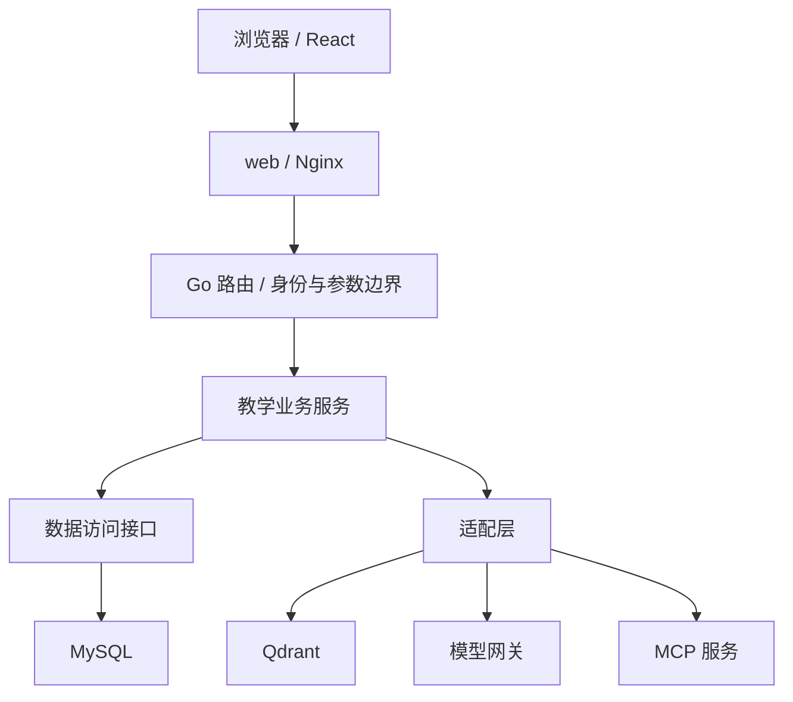

# 架构与目录职责

技术栈沿用 React + TypeScript、Go、MySQL、Qdrant、SSE、MCP 与 Docker Compose。本课各模块目录内只放 README，记录职责；下图为后续实现设计。

| 目录 | 责任 | 依赖与检查 |
| --- | --- | --- |
| frontend/ | 页面、组件、API 客户端、SSE 状态与可达性 | 只调用服务端 API；不含模型密钥和授权决策 |
| backend/ | 配置、路由与鉴权、业务规则、存储与外部适配 | 依赖方向为边界→服务→数据访问；SQL 不能出现在页面/handler/新业务编排中 |
| mcp-server/ | 已授权的教学工具协议适配 | 复用服务层，逐请求验证用户与班级，禁止为模型开数据库后门 |
| deploy/ | 构建、反代、环境与发布设计 | 后续只有 web 映射对外端口；机密运行时注入 |
| apitest/ | 场景来源、接口与端到端验收 | 规划沿用 URL 对齐目录与方法名，保留个人 Python 用例格式，避免套用样例 JSON |
| docs/ | 项目、运行说明、决策与证据 | 运行结论写明环境、命令、退出码与适用范围 |
| harness/rules/ | 常驻生成约束 | 由 AGENTS.md 的加载矩阵指向 |
| .agents/skills/ | 按动作调用的流程 | 统一输入、步骤、产出与停止条件 |
| openspec/changes/ | 当前 change 的四件套 | proposal/design/specs/tasks，长期 specs 仅归档时更新 |

## 后续运行底座

先确认主干保护、成员身份与规约评审，再从固定个人提交评审迁移；只执行骨架一组。目标包含配置缺失即失败、匿名 /health 聚合就绪、/live 存活、请求标识、单行 JSON 日志、优雅停机与一键启动。对外契约见 change 的 specs，不以本页替代验收。

新增包按职责建立；沿用个人 auth/materials/retrieval/tutor/mcp 的能力名称，持久化边界先记录再迁移。七项教学扩展后续单独拆 change，不在骨架中生成空业务接口或大批 CRUD。
