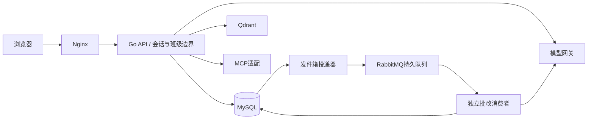

# 架构与目录

React/TypeScript经Nginx访问Go API；MySQL保存业务事实，Qdrant提供向量检索，教学会话使用SSE，工具调用经受控MCP适配。

学生提交时只在一个事务中写submissions、grade_tasks与grade_outbox，再返回202。relay在事务外发布并等待确认；worker短事务领取租约，事务外调用模型，结果事务提交后才ACK。投递可重复，唯一约束与租约标识保证一份生效结果。重试事件和死信事件也通过发件箱可靠发布。

| 目录 | 职责 |
| --- | --- |
| frontend/ | 页面、类型化API、SSE与可取消的任务轮询；不承担授权或评分 |
| backend/internal/curriculum/ | 知识点与收藏、教师私有教案、本班检索及独立模型适配；存储事务与增量迁移复用服务端身份 |
| backend/internal/grading/ | HTTP参数/身份边界、存储事务、队列和模型适配；SQL集中于存储层 |
| backend/cmd/ | API、worker、relay三个独立入口 |
| backend/internal/auth、materials、retrieval、tutor、mcp/ | 会话、资料、检索、学习智能体与工具的现有契约；持久化兼容例外见后端规则E1 |
| mcp-server/ | 令牌校验的教学工具演示服务，不直接写成绩或读取班级数据库 |
| deploy/ | 前端多阶段构建和Nginx反代；Compose仅web绑定本机端口 |
| apitest/ | 按URL/方法组织的正常、失败与边界场景，本地模型替身及合成数据清理 |
| scripts/ | 私有验证配置、OpenAPI生成与资产检查入口 |
| reports/ | 异步、安全与评审的必要复现记录 |
| harness/rules/、.agents/skills/ | 常驻领域规则与按动作调用的流程技能 |
| openspec/changes/ | 当前四件套；长期specs只由归档同步 |

任务状态、错误分类、重试预算与验证阈值以[异步规约](../openspec/changes/2026-11-04-async-grading/specs/async-homework-grading/spec.md)为准。`grade.jobs`与`grade.dead`均为持久队列，消息持久化、手工确认、prefetch=1；死信只保留待检查，不自动重放。

回退时停止新提交入口及relay/worker，保留新增表、待办和结果；恢复新版本后继续消费。隔离环境已验证消费者与代理恢复，正式发布的备份恢复、异机启动和合入仍须独立评审。

教师终评经角色/班级校验，锁定提交并比较expected_version；当前终评与追加历史同事务写入。AI初判记录保留，后到或重复消息不能覆盖终评。错题查询取每作业最新作答，优先使用教师判断，否则使用AI判断。

备课仅检索指定本班资料，模型调用在事务外进行；结构、时间和引用校验通过后，保存事务再次核对来源。教案按创建教师与班级共同隔离，不进入班级资料或学生检索索引。同键重试复用已保存草稿，编辑以版本号防止覆盖。

讲题过程复用解题引导提示与SSE传输。短事务领取在途租约，模型生成在事务外执行；校验和保存完成后才发送成功事件。阶段由学生操作与服务端前置条件推进，刷新读取持久化记录，不由模型输出设置状态。

图谱按班级/学科串行维护关系并检查成环；生成候选保存在教师私有范围，审核事务复核来源后纳入正式目录。节点资源复用原资料及单题权限，终评统计与即时错题投影分开计算。

命题复用本班检索与独立模型适配，结构化输出先校验，教师审核后整批入私有题库。试卷选择时复制题面并由服务端计算总分，后续改题或删题不改变快照。生成预算121秒，Nginx读取等待130秒以保留受控错误返回时间。

学情诊断复用终评与知识点关联，在只读一致性快照中计算统计；模型只解释汇总，不读取作答正文或改变成绩。本班学习工具通过本地MCP发现、指纹批准与统一执行入口调用知识点和统计服务；JSON-RPC沿用登录会话，逐次复核身份，工具参数不接受身份字段。

复习服务从当前有效错题及个人收藏幂等同步卡片；查询和review_plan工具只读，完成操作在行锁与版本约束下写入历史和下次安排。错题卡完成与新作答共用作业锁，防止已失效源继续推进。站内提醒每60秒及页面操作后刷新。

多题发布将试卷快照映射为有序独立作业，整卷提交在同一事务复用逐题submission/task/outbox；消费者、初判和终评继续使用同一链路。原单题列表排除父卷题，其直接提交返回409；扩展页面通过作业的paper_id跳回父卷。整卷反馈批量读取，按当前终评汇总总分。
