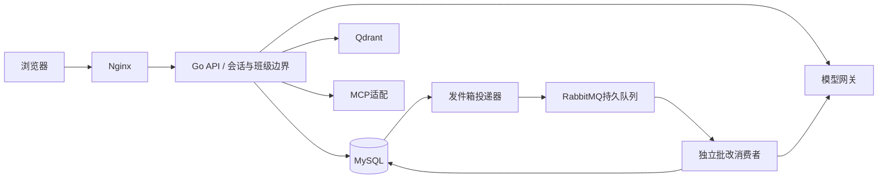

# 架构与目录

React/TypeScript经Nginx访问Go API；MySQL保存业务事实，Qdrant提供向量检索，教学会话使用SSE，工具调用经受控MCP适配。

学生提交时只在一个事务中写submissions、grade_tasks与grade_outbox，再返回202。relay在事务外发布并等待确认；worker短事务领取租约，事务外调用模型，结果事务提交后才ACK。投递可重复，唯一约束与租约标识保证一份生效结果。重试事件和死信事件也通过发件箱可靠发布。

| 目录 | 职责 |
| --- | --- |
| frontend/ | 页面、类型化API、SSE与可取消的任务轮询；不承担授权或评分 |
| backend/internal/grading/ | HTTP参数/身份边界、存储事务、队列和模型适配；SQL集中于存储层 |
| backend/cmd/ | API、worker、relay三个独立入口 |
| backend/internal/auth、materials、retrieval、tutor、mcp/ | 会话、资料、检索、学习智能体与工具的现有契约；持久化兼容例外见后端规则E1 |
| mcp-server/ | 令牌校验的教学工具演示服务，不直接写成绩或读取班级数据库 |
| deploy/ | 前端多阶段构建和Nginx反代；Compose仅web绑定本机端口 |
| apitest/ | 按URL/方法组织的正常、失败与边界场景，本地模型替身及合成数据清理 |
| scripts/ | 私有验证配置、OpenAPI生成与资产检查入口 |
| reports/ | 异步、安全与评审的必要复现记录 |
| harness/rules/、.agents/skills/ | 常驻领域规则与按动作调用的流程技能 |
| openspec/changes/ | 当前四件套；长期specs只由归档同步 |

任务状态、错误分类、重试预算与验证阈值以[异步规约](../openspec/changes/2026-11-04-async-grading/specs/async-homework-grading/spec.md)为准。`grade.jobs`与`grade.dead`均为持久队列，消息持久化、手工确认、prefetch=1；死信只保留待检查，不自动重放。

回退时停止新提交入口及relay/worker，保留新增表、待办和结果；恢复新版本后继续消费。隔离环境已验证消费者与代理恢复，正式发布的备份恢复、异机启动和合入仍须独立评审。

教师终评经角色/班级校验，锁定提交并比较expected_version；当前终评与追加历史同事务写入。AI初判记录保留，后到或重复消息不能覆盖终评。错题查询取每作业最新作答，优先使用教师判断，否则使用AI判断。
